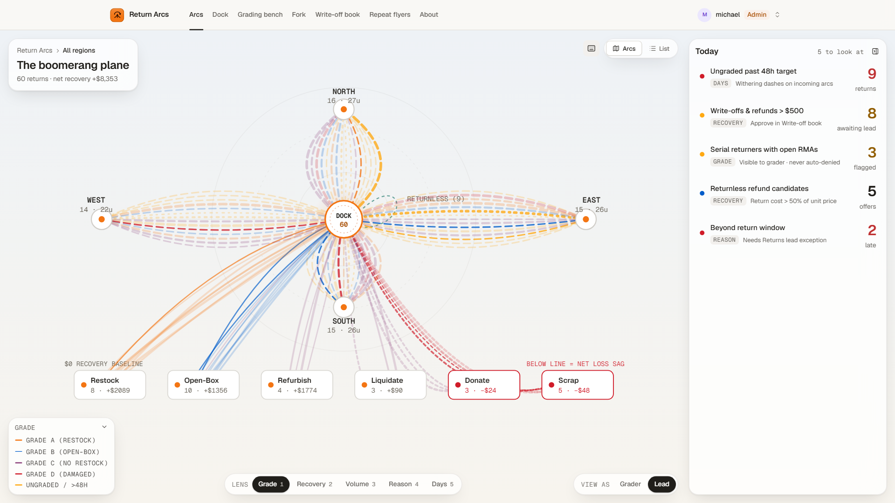

# Return Arcs

Grade every post-holiday return, compute the net recovery value of every disposition bay, route each box to its best outcome, offer returnless refunds when shipping back costs more than the item, and surface repeat-returner signals without auto-denying.



## The problem & rules

Post-Cyber-Week returns arrive from early December through the end of January. Without structured grading and recovery economics, damaged or opened goods go straight back to shelf, low-value items cost more in shipping and handling than they are worth, and high-value refunds or late exceptions slip through without lead sign-off.

Return Arcs enforces five deterministic rules (defined in `src/domain/config.ts` and `src/domain/rules.ts`):

1. **Holiday & standard return window** — 30-day standard window, extended to Jan 31 for orders placed Nov 1–Dec 24; arrivals outside the window become `late` and require a Returns lead exception.
2. **Disposition value ladder** — Computes net per-unit recovery across Restock (`price × 0.97 − handling`, Grade A only), Open-Box, Refurbish (defective electronics), Liquidate (`unitCost × 0.25 − handling`), Donate (`−handling × 0.5`), and Scrap (`−disposalFee`). Grades C and D can never restock.
3. **Returnless refund** — When `handling + returnShipping > unitPrice × 0.5`, offers a refund without shipping the item back.
4. **Serial returners** — Flags customers at `≥ 40%` return rate with at least `5` returns in 12 months, or `2+` bracketed sizes, for grader awareness (never auto-denies).
5. **Refunds & lead approval** — Deducts `15%` damage fee on Grade C/D non-defective returns; refunds over `$500` and scrap/donate write-offs stay pending until the Returns lead approves.

## What it looks like

The home centrepiece (**The boomerang plane**) is a compass drafting plane with four regional origin nodes (North, South, East, West) feeding incoming arcs into a central Returns Dock, and outgoing arcs fanning out to six disposition bays along the zero-dollar recovery baseline. Arc thickness encodes unit count, dash speed encodes age (with withering dashes past the 48-hour grading SLA), and outgoing arc height encodes recovery value so negative-value scrap arcs visibly sag below the baseline.

- **Lenses (1–5):** Grade, Recovery value, Volume, Reason, Days in process.
- **View as (V):** Grader or Returns lead.
- **Tools:** Dock, Grading bench, Fork, Write-off book, Repeat flyers, About.
- **Fallbacks:** Accessible List view (`L`) with expandable Value Ladder per return, `?nowebgl` compatible SVG stage, and full `prefers-reduced-motion` support.

## Prerequisites

- Microsoft Fabric Apps workload enabled in a workspace on a Fabric capacity
- Workspace **Edit** permission to deploy and apply the Rayfin data schema
- Node.js 20+ (tested on Node 24)

## Run locally

```bash
# At the repository root
npm install

# Demo mode (in-memory store, deterministic seed, persona switcher) on port 5239
npm run dev -w @x10/return-arcs

# Connected to Microsoft Fabric
npm run dev:fabric -w @x10/return-arcs
```

## Deploy

```bash
cd apps/return-arcs
npx rayfin up --workspace-id <workspace-id>
```

## Seed & admin setup

```bash
# Seed a deployed Fabric workspace and grant your account Returns lead (admin)
npm run seed:fabric -w @x10/return-arcs -- --admin-email you@org.com
```

## How it works

| Entity | Key fields | Row-level security | Domain enforcement |
| --- | --- | --- | --- |
| `ReturnCase` | `rmaNo`, `sku`, `category`, `orderedAt`, `requestedAt`, `receivedAt?`, `customerRef`, `reason`, `unitPrice`, `unitCost`, `units`, `origin`, `status`, `grade?`, `disposition?`, `refundAmount`, `refundApproved`, `graderSub?` | `authenticated` read & create; update/delete `claims.sub.eq(item.graderSub)` | Unique RMA, Rule 1 window, Rule 2 restock lock & override reason, Rule 3 returnless check, Rule 5 damage fee & lead-only approval |
| `DispositionPolicy` | `category`, `grade`, `resaleRate`, `handlingCost`, `refurbCost`, `disposalFee`, `returnShipping` | `authenticated` read | Policy updates restricted to Returns lead in domain |
| `ReturnerStat` | `customerRef`, `orders12m`, `returns12m`, `sizesBracketed` | `authenticated` read | Updates restricted to Returns lead in domain; Rule 4 never auto-denies |

## Known limits

- Rayfin DAB row policies cannot express cross-role admin overrides (`graderSub !== lead.sub`) on the same `ReturnCase` row; Returns lead approvals on cases graded by another user are enforced in `src/domain/returns.ts` and would use a separate approval child entity in multi-tenant production.
- Returnless refund shipping estimates come from per-category `DispositionPolicy` rather than live carrier rate APIs.

## Later

- Barcode scanner keyboard-wedge integration at the Dock.
- Automated carrier label cancellation when a returnless refund is accepted.
- Exportable recovery-value ledger for finance reconciliation.

## Gallery

**Title:** 12 Days of Fabric Apps: Day 1.7 – Return Arcs

**Blurb:** Built by Datachain Consulting for AI at Work, Return Arcs turns post-holiday reverse logistics into a visual boomerang compass. Incoming arcs from four regions converge on the Returns Dock and fan out to six disposition bays whose arc height shows net recovery value—so scrap sags below the baseline. Five pure rules enforce holiday return windows, lock Grade C and D items out of restock, offer returnless refunds on low-value goods, flag repeat returners without auto-denying, and hold refunds over $500 for lead approval.

**Tags:** `Partner | 12 Days of Fabric Apps`
